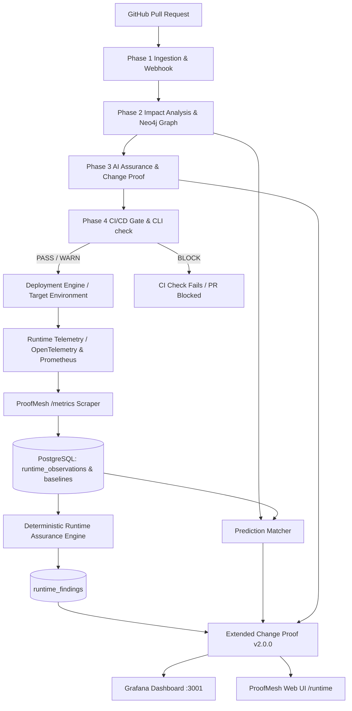

# Phase 4 Architecture — CI/CD & Runtime Assurance

## Architecture Diagram

## Data Models

### 1. `deployments`
- `id`: UUID
- `repository_id`: Foreign key to `repositories.id`
- `change_id`: Foreign key to `changes.id`
- `analysis_run_id`: Foreign key to `analysis_runs.id`
- `commit_sha`: Git commit hash
- `environment`: `staging` | `production` | `canary`
- `status`: `NOT_DEPLOYED` | `DEPLOYING` | `DEPLOYED` | `CANARY` | `ROLLED_BACK` | `FAILED`
- `deployed_at`, `created_at`

### 2. `runtime_baselines`
- `id`: UUID
- `deployment_id`: Foreign key to `deployments.id`
- `service_name`: Name of service
- `endpoint`: HTTP endpoint path or wildcard
- `request_rate`, `error_rate`, `p50_latency_ms`, `p95_latency_ms`, `p99_latency_ms`
- `sample_window_seconds`: Baseline window duration

### 3. `runtime_observations`
- `id`: UUID
- `deployment_id`: Foreign key to `deployments.id`
- `service_name`, `endpoint`
- `request_count`, `error_count`, `error_rate`
- `p50_latency_ms`, `p95_latency_ms`, `p99_latency_ms`
- `status_2xx_count`, `status_4xx_count`, `status_5xx_count`
- `observed_at`

### 4. `runtime_findings`
- `id`: UUID
- `deployment_id`: Foreign key to `deployments.id`
- `finding_type`: `RUNTIME_HEALTHY` | `RUNTIME_REGRESSION` | `PERFORMANCE_REGRESSION` | `ERROR_RATE_REGRESSION` | `AVAILABILITY_REGRESSION` | `INSUFFICIENT_RUNTIME_EVIDENCE`
- `severity`: `LOW` | `MEDIUM` | `HIGH` | `CRITICAL`
- `service_name`, `endpoint_or_metric`
- `baseline_value`, `observed_value`, `threshold_value`
- `evidence`: Human-readable and machine-auditable narrative
- `confidence`: Confidence score (0.0 - 1.0)

### 5. `ci_assurance_checks`
- `id`: UUID
- `change_id`: Foreign key to `changes.id`
- `commit_sha`: String
- `gate_decision`: `PASS` | `WARN` | `BLOCK` | `INSUFFICIENT_EVIDENCE`
- `policy_summary`: JSON
- `exit_code`: Integer
- `github_check_id`: Optional external check run identifier
- `created_at`
